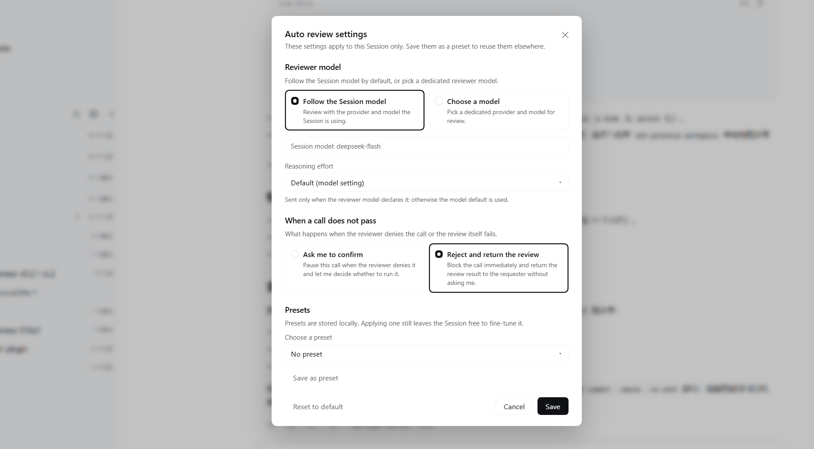

# dsh-better-approve

[](https://www.npmjs.com/package/dsh-better-approve)
[](LICENSE)
[](package.json)
[](https://github.com/deepseek-ai/deepseek-harness)

**English** | [简体中文](README.zh.md)

An enhanced implementation of DeepSeek Harness's native **Auto review**
(Approve for me) permission mode. It provides a custom reviewer model and
reasoning effort, changes how a failed review is reported, and can reject
automatically instead of waiting for manual confirmation. It also fixes
problems that can occur in native Auto review.



## Features

The plugin adds a new review settings panel once DSH's Auto review permission
mode is enabled. It includes:

- **Custom reviewer model**: choose the provider, model, and reasoning effort
  used for review. The options come from the models already configured in DSH.
- **Automatic rejection**: choose how a failed review is reported. Native Auto
  review asks the user for a second manual review after a denial, which pauses
  the Session; without human intervention, this blocks long-running agent
  tasks. The plugin offers an automatic rejection option that returns the
  review result to the requester as a denial, so the Session is not blocked.
- **Reusable presets**: save the current settings as a preset and apply them to
  other Sessions in one click.
- **Fix for native reviewer failures**: review requests no longer send
  `temperature`, which fixes the errors native Auto review hits on those APIs.

## Requirements

- DeepSeek Harness `>=0.2.1-rc.2 <0.3.0`

## Installation

Installing from npm is recommended:

```bash
dsh plugin --profile web add dsh-better-approve
```

You can also give this repository's URL to a DSH session and ask the Agent to
install it.

## Usage

1. Enable the DSH native experimental plugin **Auto review**.
2. Choose **Auto review** in the Session's permission picker (the native entry
   is unchanged).
3. A **Review settings** button appears in the composer tool row; click it to
   open the settings for the current Session.
4. Choose the reviewer source:
   - follow the current Session model (default), or
   - specify a provider, model, and reasoning effort.
5. Choose what happens when a review does not pass.
6. To reuse the settings, click Save as preset; other Sessions can then select
   it from the Presets dropdown.

## Security

- **Only use trusted providers for model review. A malicious provider
  increases the risk of attack.**
- The review prompt and fixed risk policy, the risk classification
  (low / medium / high), and the Session-history reconstruction match the
  native implementation.
- The review prompt contains the reconstructed Session context and the pending
  call, and is sent to the reviewer provider configured for that Session (by
  default the Session's own route). **Do not choose a reviewer provider you
  would not share that context with.**
- Like native Auto review, this plugin provides no file sandbox; allowed calls
  execute with full permissions. **Auto review can still misjudge.**

## Contributing

Issues and pull requests are welcome. See [CONTRIBUTING.md](CONTRIBUTING.md)
for the development process.

## License

MIT — see [LICENSE](LICENSE). Copyright (c) 2026 Yutong Zou.

This project is not affiliated with or endorsed by DeepSeek. It contains code
derived from DeepSeek Harness (also MIT licensed); see
[THIRD_PARTY_NOTICES.md](THIRD_PARTY_NOTICES.md) for the attribution and the
upstream license text.
